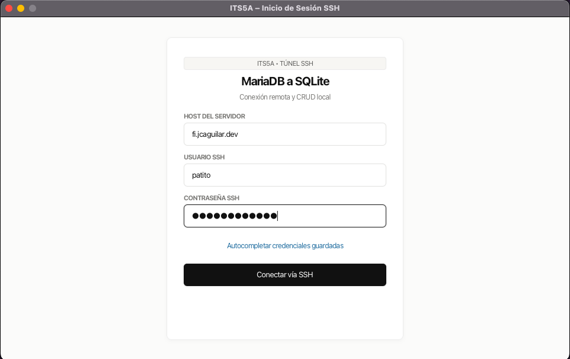
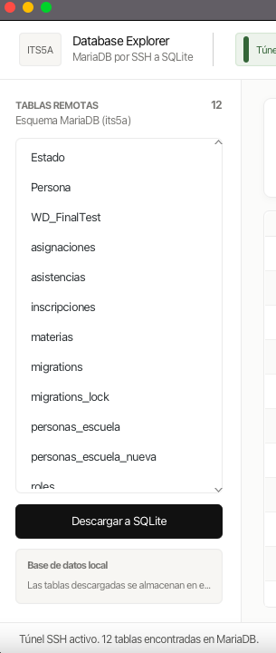
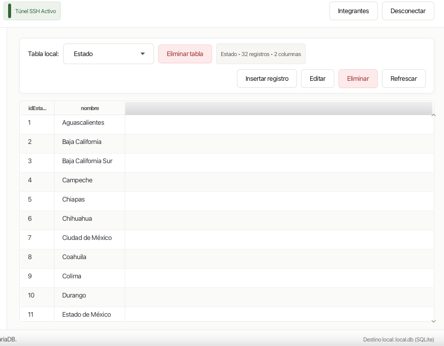
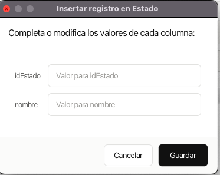
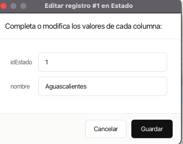
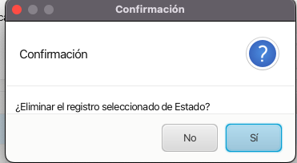
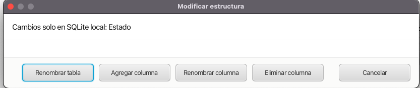
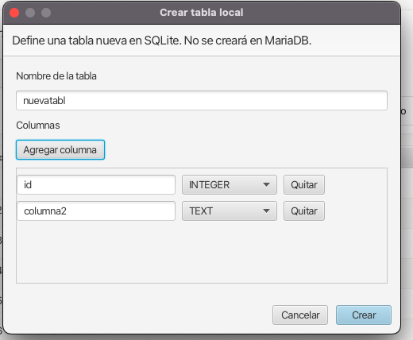

# Mini DBeaver

Aplicación de escritorio hecha con Java 21 y JavaFX. Abre un túnel SSH a un servidor, consulta las tablas de MariaDB `its5a`, permite descargar una tabla a SQLite local y ejecutar operaciones CRUD sobre esa copia local.

## Requisitos

- JDK 21
- Maven 3.9 o posterior
- Acceso SSH al servidor y credenciales autorizadas para MariaDB

Comprueba que Java y Maven estén instalados:

```bash
java -version
mvn -version
```

## Configuración inicial

Las credenciales de MariaDB no se guardan en el repositorio. Antes de ejecutar la aplicación:

1. Copia la plantilla:

   ```bash
   cp src/main/resources/db.properties.example src/main/resources/db.properties
   ```

2. Edita `src/main/resources/db.properties` y reemplaza `CAMBIAR_USUARIO_MARIADB` y `CAMBIAR_CONTRASENA_MARIADB` con los valores que tengas autorizados:

   ```properties
   db.name=its5a
   db.user=CAMBIAR_USUARIO_MARIADB
   db.password=CAMBIAR_CONTRASENA_MARIADB
   db.remotePort=3306
   ```

   `db.remotePort` es el puerto MariaDB visto desde el host SSH. La aplicación crea un túnel hacia `127.0.0.1` en ese puerto. El usuario y contraseña de este archivo son las credenciales de MariaDB; las credenciales SSH se escriben en el login o se cargan desde el archivo local `ssh.properties`.

El archivo `db.properties` está excluido de Git. No lo compartas ni lo añadas manualmente al repositorio. La plantilla `db.properties.example` no contiene secretos y sí debe compartirse.

### Autocompletar el inicio de sesión SSH

El botón **Autocompletar credenciales guardadas** puede rellenar host, usuario y contraseña SSH desde un archivo opcional en la raíz del proyecto:

1. Copia la plantilla:

   ```bash
   cp ssh.properties.example ssh.properties
   chmod 600 ssh.properties
   ```

2. Edita `ssh.properties` y cambia `CAMBIAR_USUARIO_SSH` y `CAMBIAR_CONTRASENA_SSH` por tus credenciales autorizadas. `chmod 600` restringe el acceso al archivo a tu usuario en macOS/Linux.
3. Pulsa **Autocompletar credenciales guardadas** en la pantalla de inicio.

`ssh.properties` está excluido de Git y se lee desde el directorio raíz de ejecución. Si no creas ese archivo, puedes escribir manualmente las credenciales en el formulario. No escribas las contraseñas en el código fuente ni compartas ese archivo.

## Ejecución

Desde la raíz del proyecto:

```bash
mvn javafx:run
```

Para compilar y validar el proyecto:

```bash
mvn clean package
```

También existe un script auxiliar:

```bash
./run.sh
```

`run.sh` es un script de shell que cambia al directorio del proyecto, configura `JAVA_HOME` y ejecuta `mvn javafx:run`. En este proyecto apunta a una ruta local concreta de JDK en macOS (`$HOME/.jdks/temurin-21.0.13/Contents/Home`), así que puede no existir en otros equipos. Si el script no funciona, usa `mvn javafx:run` directamente o cambia la ruta de JDK en el script.

Al abrir la aplicación, introduce las credenciales SSH manualmente o usa el botón de autocompletado si configuraste `ssh.properties`; luego selecciona **Conectar vía SSH**.

## Uso de la aplicación

1. La aplicación abre el túnel SSH y conecta con MariaDB.
2. El panel izquierdo muestra las tablas remotas disponibles.
3. Selecciona una tabla remota y pulsa **Descargar a SQLite**.
4. Elige la tabla descargada en el selector local para consultar sus registros.
5. Inserta, edita o elimina filas desde los controles CRUD.
6. También puedes crear tablas locales vacías y modificar su estructura: renombrar una tabla, agregar columnas o renombrar/eliminar columnas.
7. Usa **Eliminar tabla** para borrar una tabla local completa, previa confirmación. Esta acción no elimina tablas de MariaDB.

Las operaciones sobre filas y estructura afectan solo a `local.db`. Si vuelves a descargar una tabla que ya existe, su copia local se reemplaza con la definición y los datos de MariaDB; los cambios locales de esa tabla se pierden.

La aplicación no precarga tablas ni registros de ejemplo. Las tablas locales aparecen cuando descargas una tabla real de MariaDB o cuando usas explícitamente **Crear tabla**; las creadas manualmente empiezan vacías. `local.db` conserva las tablas entre ejecuciones.

Al eliminar una columna se pierden sus valores y la aplicación solicita confirmación. SQLite exige que cada tabla conserve al menos una columna. Los tipos disponibles para nuevas tablas y columnas son `TEXT`, `INTEGER`, `REAL` y `BLOB`. Las operaciones de esquema se hacen mediante SQLite y no cambian la tabla original de MariaDB.

## Arquitectura y estructura

El proyecto separa las responsabilidades siguiendo MVC:

- **Modelo (`model/`)**: representa los datos y concentra la lógica de persistencia y acceso a los servicios.
- **Vista (`resources/.../view/` y `view/`)**: describe la interfaz en FXML/CSS y el diálogo de edición.
- **Controlador (`controller/`)**: responde a acciones del usuario, coordina vistas y modelos y mantiene el estado de la pantalla.

```text
.
├── pom.xml                              # JDK, dependencias y plugin JavaFX de Maven
├── run.sh                               # Script opcional para el JDK del entorno original
├── .java-version                        # Versión de Java indicada para el proyecto
├── .gitignore                           # Excluye compilación, base local y archivos de credenciales
├── ssh.properties                       # Credenciales SSH opcionales; ignoradas por Git
├── ssh.properties.example               # Plantilla para configurar el autocompletado SSH
├── Screenshots/                         # Capturas de la aplicación para la entrega
└── src/main/
    ├── java/com/its5a/
    │   ├── app/
    │   │   └── App.java                 # Arranque JavaFX y primera ventana
    │   ├── controller/
    │   │   ├── LoginController.java     # Validación del login y conexión SSH
    │   │   └── MainController.java      # Descarga, selección y CRUD de tablas locales
    │   ├── model/
    │   │   ├── LocalDatabase.java       # Acceso SQLite y operaciones CRUD/esquema
    │   │   ├── RemoteService.java       # Túnel SSH y consultas MariaDB
    │   │   └── TableData.java           # Estructura común para filas y columnas
    │   └── view/
    │       ├── RecordDialog.java        # Formulario de alta y edición de registros
    │       └── TableSchemaDialog.java   # Formulario para crear tablas locales
    └── resources/
        ├── db.properties                # Configuración privada local; ignorada por Git
        ├── db.properties.example        # Plantilla sin secretos para crear la configuración
        └── com/its5a/view/
            ├── login.fxml               # Pantalla de inicio de sesión
            ├── main.fxml                # Explorador de tablas y CRUD local
            └── style.css                # Estilos compartidos de JavaFX

local.db                                 # Se crea al ejecutar; SQLite local, ignorada por Git
target/                                  # Salida de Maven, ignorada por Git
```

`ssh.properties` solo existe si se crea copiando la plantilla. `db.properties` también debe crearse localmente desde su plantilla. Ninguno de esos dos archivos privados debe incluirse en la entrega pública.

### Flujo entre capas

1. `App` crea la vista FXML del login y JavaFX instancia `LoginController`.
2. `LoginController` valida los campos (escritos manualmente o cargados desde `ssh.properties`) y crea `RemoteService` en una tarea en segundo plano.
3. `RemoteService` lee la configuración privada, abre el túnel SSH y usa JDBC para consultar MariaDB.
4. `MainController` solicita la lista remota, pide la descarga de la tabla seleccionada y coordina las operaciones sobre `LocalDatabase`.
5. `LocalDatabase` guarda los datos en `local.db`; la interfaz muestra las filas y columnas usando la vista principal.
6. `RecordDialog` recopila valores para altas y ediciones de registros; `TableSchemaDialog` captura columnas y tipos para crear una tabla local.
7. `MainController` ofrece cambios de esquema y delega en `LocalDatabase`, que ejecuta `CREATE TABLE`, `ALTER TABLE` y `DROP TABLE` solo en SQLite.

## Capturas para la entrega

Las siguientes capturas están guardadas en `Screenshots/` y muestran la aplicación en funcionamiento:

### 1. Inicio de sesión



### 2. Conexión y listado de tablas remotas



### 3. Tabla descargada y registros en SQLite



### 4. Insertar y editar registros





### 5. Confirmación al eliminar un registro local



### 5. Crear y editar una tabla






## Integrantes

- `[Alberto Benjamin Poot Veloz]` — `[75468]`
- `[Royfran R Santini Pacheco]` — `[68994]`
- `[Bryan A Figueroa Quintal]` — `[75718]`
